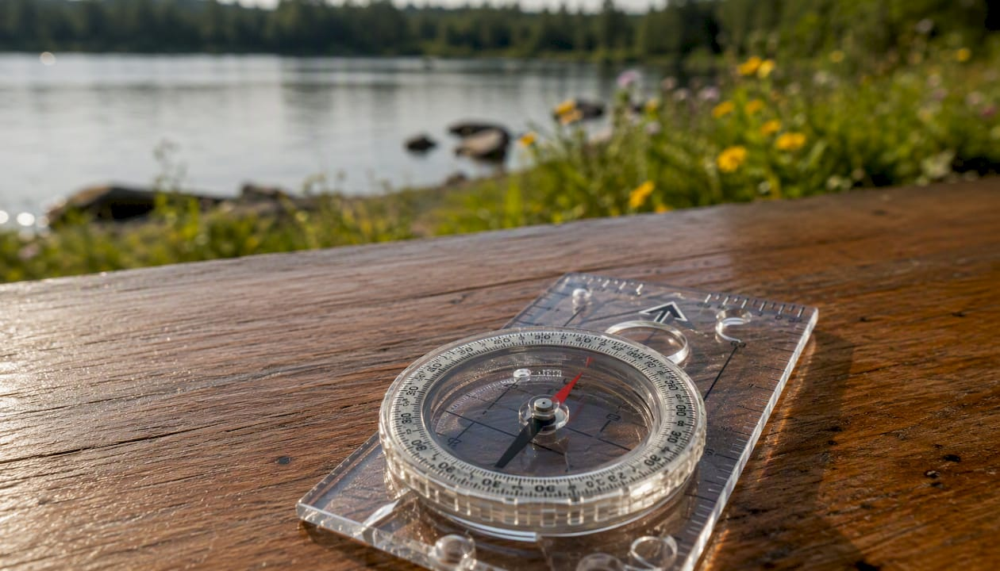

<!DOCTYPE html>
<html lang="en">
<body>
<pre>
-> Here a minimal python 2d runtime coordinate system (GPU accelerated)
(no pointer) (no advance memory management) just the minimal context needed to focus
on the essential math for a simple 2d screen (the base of any screen interaction)
when importing vec2 and vec3 from the folder lib, we can easily experiment matrix 3x3 transformations
of simple 2d system (rotation_x + rotation_y + translation),
        
note: (this involve vec3, the third dimension act as translation for fast 3x3 matrix multiplications)

-> At first stay simple !
focus on the 'main.py' file only and customize the event loop only:
# 2D Geometry & Math Experimentation

Here is the main rendering loop using GLFW and custom 2D drawing logic inspired by Blender geometry nodes:

```python
while not glfw.window_should_close(window):
        glfw.poll_events()
        aa_renderer.draw_grid()
        # custom code from there 
       
        # your code 2d experimentation
        # like circle intersection line intersection ect...
        # take inspiration from the blender geometrynode series
        # to there
        glfw.swap_buffers(window)
```

use renderer.draw_grid() , renderer.draw_line(...) ect... for an even faster
system without anti aliasing but honestly unless running on raspberry pi
this may not even needed.

overall the perfect setup for learning vectors transformations on a minimal application.
and don't worry about low level language just yet, clean your mind first with the true 
mathematical notions with the less frictions as you can (there are no zero cost abstraction in python 
so fancy api does'not worth it python for graphical computing).

This can can be run with ./venv/bin/python main.py


<a href="https://www.example.com">
  
</a>
</pre>
</body>
</html>


