<a href="https://www.example.com">
  
</a>

### Objective:

Use python to establish a software self awareness mesh in our property fully customizable by human and IA and 
in a total LEGITIMATE privacy, with secure (non compiled) open source scripts that allow us to "SENSE" different part 
of our property.

At the era of agentic IA, staying proactive by scripting/planing our environment is very IMPORTANT to stay close
of the mathematics/cognitive awareness in a stimulating daily routine that keep us dreaming and involved,  
who want an humanity where humans are just cows in fields ?  
the process of thinking, planing, interacting with low level hardware is, needed and will be controlled/supervised by agent anyway...
but this cyber culture is very important, else what our boots will just walk over ourselves in the most pathetic way, if we are not educated 
to the consequence of our own wishes.

in the Aladdin myth the genie became slave of it's own power and finish to be trap in the consequence bottle of the
lamp (the enlightenment) and obey to it's master, the owner of the lamp.

we need awareness to understand consequences of our choices and staying the owner of the lamp us the PEOPLE. 

### Contextual Sensitivity:

<!DOCTYPE html>
<html lang="en">
<body>
<pre>
Keeping in mind that avoiding to share data without our permission is the basement of each commercial pressure,  
necessary to any commercial exchanges IT'S THE FIRST REALITY TO ACCEPT.  
  
As owner we deserve to have the means to check the source of what we are running on our devices.
specially when this may involve, those we love the most.
  
We start first with a simple text data stream via UDP protocol, it's more than enough to synchronize stuff 
in a real and useful way, like monitoring some gardening goods and logging data this will allow reproducible 
LOCAL recipes this will simply serve the peoples IN their daily FIRST needs of effective programing with python.

So Devices communications are very important and not an easy topic and have to be process with the minimal friction
as possible syncing two devices over a private Network should not be an obscure science, an python is the good balance
between software engineering and user customization. 

Articulating functionality with ease is the real objective, python achieve this.

compiled proprietary lib can also be used when sharper performances are required nothing forbid that.

</pre>
</body>
</html>


### Quotes: "We love only what we understand. we approve if we can't get any faster"

### How it work:
<!DOCTYPE html>
<html lang="en">
<body>
<pre>
                                        
  The process happen on 2 sides:

Server: 
		- One side on the server ( the part that sends the data ) we call it the server side.
Client:
          		- The other part is the client side the part that receives the data. (We call it the client side ).

Both sides will agree on an handshake and start to exchange data each other (they get in sync automatically).
Once aware each other, the client start to send str data every heartbeat delay, once received, the simple python str
is just stored in a list on the other side of the network, a simple python script can process the str and trigger conditionally 
an action before cleaning the list of the instruction once recieved. 

By this simple process both app locally on the same network can have awareness and share data and synchronize
thinks like portals, pumps, lights, amd of course the familiar machine gun can still be driven like any thing else 
but remember it’s not the hammer that kill ! it is the murderer right ? Ugly sure, but IA video analysis is also the hope, 
to balance with, the inventor of the hammer have no regret i’m sure. 

in practice:

First get the ip and the key on the server side:

and copy the whole project on each side of the network.
```
python3 -m udp_link ip
python3 -m udp_link keygen
```
Copy and paste the template config toml file:

```
 cp ./link.example.toml ./link.toml
```
then update the toml with ip address, port, and keygen.

the updated toml file must be copied on the folder next to the app folder on each sides

then on each side run respectively 
```
python3 -m apps.time_server --config link.toml
python3 -m apps.time_client --config link.toml
```
Ensure firewall rule and you are good to go to enjoy your python journey on your local network.


</pre>
</body>
</html>


