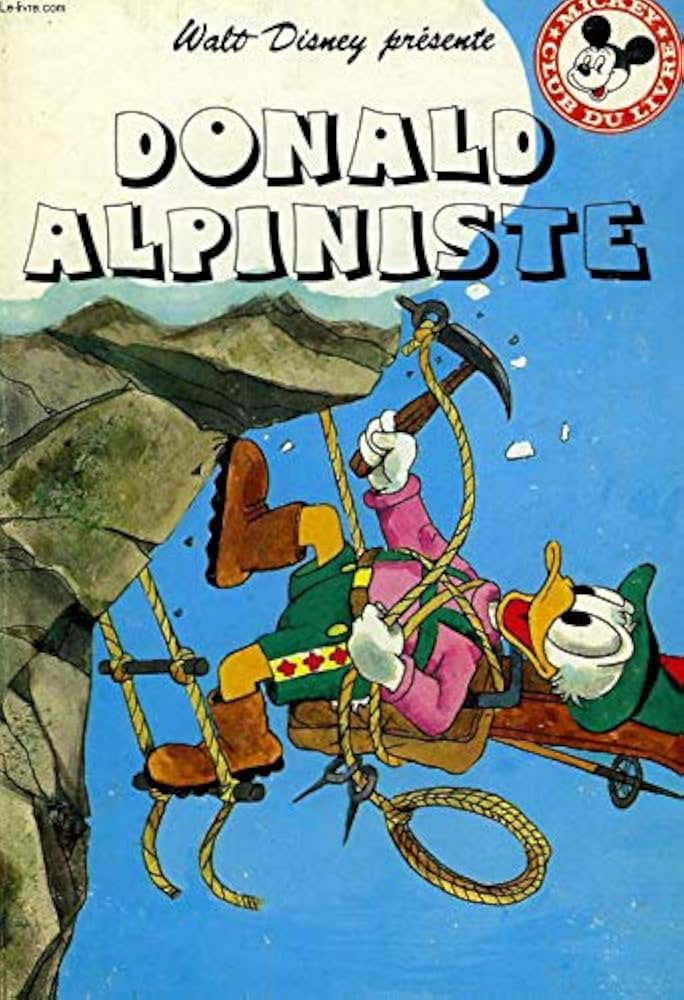

<!DOCTYPE html>
<html lang="en">
<body>
<pre>

                      
  
Quotes: "Working hard without wasting time is Art !"

this folder will establish my template knowledge for algorithm prototyping,
too technical type constrained languages are creativity breaking or too outrageous 
for some, time are obscures but python is the good old friend, with less constraints 
and clearer mathematical definitions, math are already serious enough as a whole topic by it self.

The Beauty of open source:
Python is slow, clear, easy, algorithmic solid, no memory issue, open source friendly, 
preserving "community asset" (is that still mean something at the hour of IA ?) allowing 
community to share knowledge in harmony and stimulate competence to apply and develop locality 
where at my sense are the only place where money and service feed back should come from, i mean 
no point to have ia to stimulate articulated workflow if no kind of competences can flourish in your 
locality right ? 

The Clear Objective:
Leverage python to build complete pedagogical map of virtual reality, unlocking simulation,
geometry, mathematic interactivity, graphical simulation and measurements to finally build 
an effective software development probe to map technology and real interactions, 
synchronized in space and time with the appropriate accuracy 
and finally successfully duplicate local success where it deserve in other locality, 
to improve the process again and the world by this simple iterative behavior.

How to install the toolchain and run the programs:

step 1: 
install python

step 2:
make a new folder with the name of your choice 
( the current project will run locally embedded
inside this runtime folder )

step 3: 
copy and run the install script ( corresponding to you os )
from the python_OpenGL_toolchain folder inside you new project folder. 
( run it twice to be sure that everything are well installed )
a python check_env.py can be run inside this folder with 
./.venv/bin/python check_env.py for self auto diagnostic of the 
toolschain of your embedded folder. (simply copy and paste it inside)
requirements.txt must be copied alongside the install script for a full
diagnostic.

step 4:
copy and paste the examples of this repository the '.py' script
and run it with the local folder toolschain with:
./.venv/bin/python script_example.py

https://www.python.org/
https://docs.arduino.cc/

My though about micro-controller for future generation in this edge&violent time:

At the era of automation, micro controller sim to be a crucial way to put action and effect 
on the "intelligence surrounding" this will have inevitably positive and negative imprint,
even if we consider a garden programmer watering system like threat the biggest effect is to 
provide action and mechanical interaction with the connectivity capability which lead to hope, 
owning your environment and be able to import knowledge, exchange goods, skills an restructure 
chaos in locality, but inevitably what is destined to burn will and what destined to biggest 
ambition will eventually prosper as any changing world.

The hope for the designer scale and optimization:
https://en.wikipedia.org/wiki/Neural_processing_unit

</pre>
</body>
</html>

